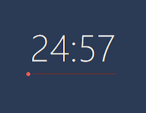
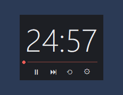
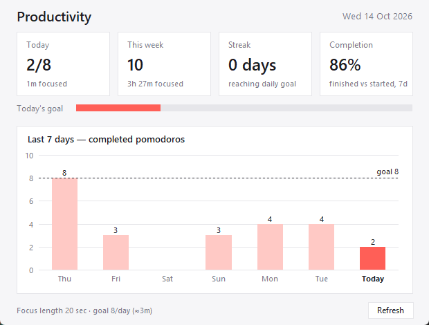

# Pomodoro Timer for Windows

นาฬิกา Pomodoro แบบ **Minimal โปร่งแสง** ลอยอยู่บนจอ รันเงียบ ๆ ใน System Tray พร้อม **Dashboard** ดู Productivity
เบา (RAM ~45 MB), ไม่ต้องติดตั้ง, ข้อมูลเก็บในเครื่องเท่านั้น

| นาฬิกา | เอาเมาส์วาง → ปุ่มควบคุม | Dashboard |
|---|---|---|
|  |  |  |

## Features
- ⏱️ ตั้งเวลา Focus / Short break / Long break / Long break ทุกกี่รอบ ได้เอง
- 🪟 นาฬิกาโปร่งแสง — ปรับความโปร่ง, ขนาด, ฟอนต์, สี, Always on top, Click-through
- 🔕 ปิดหน้าต่างแล้วยังรันใน System Tray (hover ไอคอนเห็นเวลาที่เหลือ)
- 🔔 เสียง + Windows notification เมื่อจบรอบ, Auto-start รอบถัดไป
- 📊 Dashboard: วันนี้ / สัปดาห์นี้ / Streak / Completion rate / กราฟ 7 วัน + เป้ารายวัน
- ⌨️ Global hotkey `Ctrl+Alt+P` = Start/Pause
- 🚀 Start with Windows, Export CSV

## Download & ใช้งาน
1. ไปที่หน้า **[Releases](../../releases)** → ดาวน์โหลด `Pomodoro-vX.Y.Z-win64.zip`
2. คลิกขวาไฟล์ zip → **Extract All…** ไปไว้ที่ไหนก็ได้ (เช่น `C:\Users\<ชื่อคุณ>\Apps\`)
3. เปิด `Pomodoro\Pomodoro.exe`
   > ⚠️ ถ้า Windows ขึ้น **"Windows protected your PC"** (เพราะแอปไม่ได้ซื้อ code-signing certificate) ให้กด **More info → Run anyway**
4. (ไม่บังคับ) คลิกขวา `Pomodoro.exe` → Send to → Desktop (create shortcut)

> ต้องเก็บ `Pomodoro.exe` ไว้คู่กับโฟลเดอร์ `_internal` เสมอ — ย้ายทั้งโฟลเดอร์ ไม่ใช่แค่ .exe

**ลองทุกฟีเจอร์ใน 1 นาที:** เปิดด้วย `Pomodoro.exe --demo` → นับเป็นวินาที (Focus 20 วิ) + ข้อมูลตัวอย่าง 14 วัน (แยกจากข้อมูลจริง)

| ทำอะไร | วิธี |
|---|---|
| เริ่ม / หยุด | ดับเบิลคลิกตัวเลข · `Ctrl+Alt+P` · เมนู tray |
| ปุ่มควบคุม | เอาเมาส์วางบนตัวเลข → ▶ ⏭ ⟲ ⚙ |
| ย้ายนาฬิกา | ลากที่ตัวเลข (จำตำแหน่งไว้) |
| เมนู | คลิกขวาที่ตัวเลข หรือคลิกขวาไอคอน tray |
| ปิดแอปจริง | **Quit** ในเมนู tray (Hide = ซ่อนแต่ยังจับเวลา) |

## ข้อมูลเก็บที่ไหน
เก็บในเครื่องเท่านั้น ไม่มีการส่งออกอินเทอร์เน็ต — `%APPDATA%\PomodoroTimer\`
- `settings.json` — การตั้งค่า
- `pomodoro.db` — ประวัติ session (SQLite, 1 แถว = 1 รอบ)

ปิดแอป / Shutdown / ย้ายโฟลเดอร์แอป ข้อมูลยังอยู่ · Export CSV / ลบข้อมูล ได้ที่ Settings → Data

## ถอนการติดตั้ง
ปิด "Start with Windows" ใน Settings → Quit → ลบโฟลเดอร์แอป และ `%APPDATA%\PomodoroTimer`

## Build from source
ต้องมี Python 3.10+ (Windows)
```powershell
python -m venv .venv
.venv\Scripts\python -m pip install -r requirements.txt
.venv\Scripts\python -m pomodoro --demo                 # รันจาก source
.venv\Scripts\python -m unittest                        # tests
powershell -ExecutionPolicy Bypass -File build.ps1      # -> dist\Pomodoro\Pomodoro.exe
powershell -ExecutionPolicy Bypass -File package.ps1    # -> release\ (zip + source สำหรับ GitHub)
```
Stack: Python · Tkinter · pystray · SQLite · PyInstaller

## Credits
แรงบันดาลใจจาก [Pomotroid](https://github.com/splode/pomotroid)
